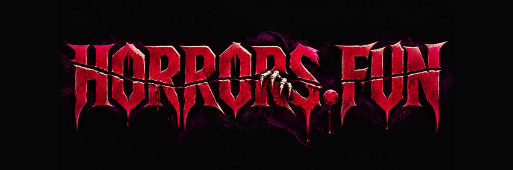

<div align="center">
  
</div>

# Cleaning Horrors

**A Horrors.Fun game.** You're the new housekeeper on the night shift. Clean 8 rooms, but something is hiding in half of them, and never the same ones twice. With 30 potential hiding spots shuffled every playthrough, your survival depends on vigilance: check every corner, listen for unusual sounds, and stay alert. The "guests" always leave subtle clues. Spotting them is your only chance to make it to morning.

Cleaning Horrors is built on [Skull Hotel](https://github.com/JamesHall38/skullhotel.io) by James Hall, released under the MIT License. The original copyright notice is kept in [LICENSE](./LICENSE).

## Installation

```bash
# Clone the repository
git clone <this-repo-url> cleaning-horrors
cd cleaning-horrors

# Install dependencies
npm install

# Start the development server
npm run dev
```

## Debug Mode 🔍

Enable debug mode by appending `/#debug` to the game's URL to access the Leva configuration panel and view grid visualizations in the browser's developer console (you may need to zoom out with Ctrl+"-" to view the grid properly, as shown in the images below).

#### Map Visualization

The game features six distinct enemy types:

- 🟩 **Raid**: If you hear knocking or see a sign, you must hide and wait for the monster to leave.
- 🟨 **Claymore**: The monster is behind a door or curtain, and you must quickly close it before it attacks.
- 🟪 **Hideout**: It hides and surprises you while you're completing objectives.
- 🟥 **Landmine**: It hides and jumps at you if you move too close.
- 🟦 **Sonar**: Located in the bathroom - you must listen at the door and avoid opening it if you hear breathing.
- 🟧 **Hunter**: It emerges from a hiding spot and chases you - your only option is to run.

The console displays your current game seed with each enemy type represented by a unique color:

<div align="center">
  
</div>

## Credits 📚

- **James Hall**: original game concept, design & development (Skull Hotel)
- **Lucas Houbre**: original user interface & art direction

- **Mixamo**: Character model and animations
- **BlenderKit**: 3D assets
- **AudioJungle**: Sound effects
- **AmbientCG**: Textures and materials
